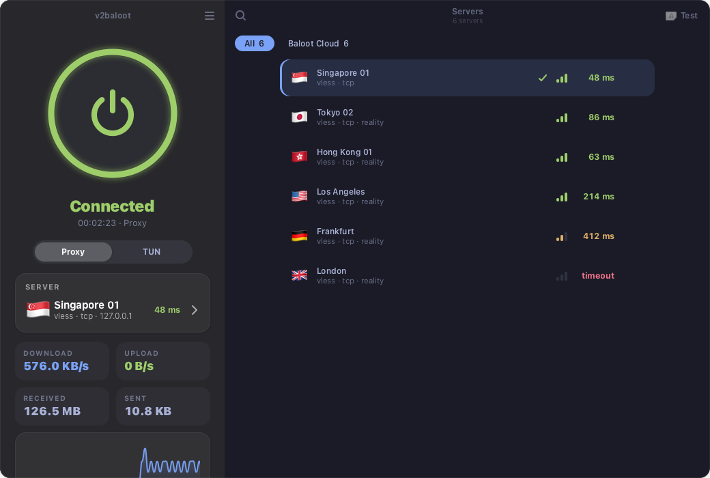
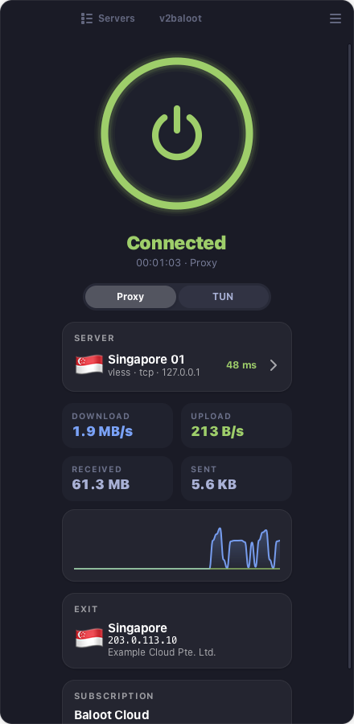

<p align="center">
  
</p>

<h1 align="center">v2baloot</h1>

<p align="center">
  An Xray (V2Ray) client made for <a href="https://omarchy.org">Omarchy</a> — GTK4 app, tray, terminal UI, Waybar and Walker, all driven by one daemon.
</p>

<p align="center">
  <a href="https://github.com/balootmhl/v2baloot/actions/workflows/ci.yml"></a>
  <a href="https://github.com/balootmhl/v2baloot/releases"></a>
  <a href="LICENSE"></a>
</p>

<p align="center">
  
</p>

## Features

- **Protocols**: VLESS (REALITY, Vision), VMess, Trojan and Shadowsocks (incl. 2022).
- **Transports**: TCP, WebSocket, gRPC, HTTPUpgrade and XHTTP.
- **Two modes**
  - **Proxy**: SOCKS5 `127.0.0.1:10808` and HTTP `:10809`, plus the desktop's system proxy.
  - **TUN**: every app goes through Xray's native TUN, with a **kill switch**. If the tunnel drops, traffic is blocked rather than leaked, and the tunnel comes back on its own.
- **Servers**: import share links from the clipboard. Subscriptions show usage and expiry and update automatically. Latency is a real delay test through each server, run in parallel.
- **Desktop**
  - A dashboard with live speed, session timer and exit IP/country, styled in your **Omarchy theme**.
  - A tray icon, a Waybar module and a Walker server menu (`Super+Alt+V`).
  - A TUI and a scriptable CLI.
- **Connectivity**: connection timeouts match V2Box. It reconnects automatically and recovers after sleep.

<p align="center">
  
</p>

## Install

**Requirements:**
- Omarchy, or Arch Linux + Hyprland with systemd-resolved.
- Xray-core 26.x from the AUR (`xray-bin`). The installer handles it.
- Being in `wheel` (the Omarchy default), for password-less TUN mode.

### AUR (recommended)

```bash
yay -S v2baloot-bin
systemctl --user enable --now v2baloot
```

### Installer script

```bash
git clone https://github.com/balootmhl/v2baloot.git && cd v2baloot
git checkout v0.1.0      # a release tag → installs the prebuilt package in seconds
./install.sh
```

`install.sh` does the following:
- Installs `xray-bin` from the AUR. It shows you the PKGBUILD first.
- Installs v2baloot:
  - On a release tag, it uses the package CI built for that tag, after checking its checksum.
  - Otherwise, or with `--build`, it builds from source. Later updates rebuild only what changed.
- Enables the user daemon.
- Offers to add the Waybar module and Hyprland keybindings, backing up those configs first.

**Update:**

```bash
git fetch --tags && git checkout <new tag> && ./install.sh
```

## Usage

```bash
v2baloot sub add 'https://provider.example/sub/xxxx'   # add a subscription
v2baloot import 'vless://…'                           # or copy a link and run: v2baloot import
v2baloot test                                         # latency test
v2baloot connect 3                                    # by list number, name or id
```

| Where | How |
|---|---|
| App | Walker → “v2baloot”, or `v2baloot-gui` |
| Terminal UI | `v2baloot` (press `?` for keys) |
| Waybar | click: open · middle: TUI · right: connect/disconnect |
| Tray | connect, switch servers and mode, test, import |
| Keys | `Super+Alt+V` server menu · `Super+Alt+Shift+V` connect/disconnect |
| CLI | `v2baloot status / list / toggle / mode tun / sub update / logs` |

### Proxy mode vs TUN mode

- **Proxy**: sets the proxy for GTK apps and for apps you launch afterwards. Apps that were already open need a restart. Terminal tools can use `socks5h://127.0.0.1:10808` directly.
- **TUN**: every app goes through the tunnel, including terminal tools, games and anything that ignores proxy settings. DNS and IPv6 go through it too. If something can't be tunnelled, it's blocked rather than leaked.
  - A small root unit (`v2baloot-tun@<user>.service`) sets up routing.
  - Xray itself runs as an unprivileged user with only network capabilities.
  - The **kill switch** (Preferences, on by default) blocks internet traffic while Xray restarts.

## Security

- **TUN mode is system-wide.** While it's on, every user's and service's traffic on the machine goes through the selected server, DNS included. Wheel members can start and stop their own TUN session without a password (polkit). Use it on machines where you trust the other wheel users.
- **The root helper never runs a user-supplied config.**
  - It rebuilds the Xray config from the selected server only.
  - It runs Xray as the unprivileged `v2baloot-tun` user.
  - It logs at most warnings to the journal.
- **"Allow LAN connections"** opens the proxy to your network **without a password**. It can't reach this machine's own loopback services. Keep it off on public Wi-Fi.
- **Prefer `https://` subscription links.** v2baloot warns when you add an `http://` one.
- **Text from subscriptions is sanitized.** Server names, titles and errors are stripped of terminal escape sequences and bidi tricks. Servers that point at this machine are ignored.

Please report vulnerabilities privately; see [SECURITY.md](SECURITY.md).

## Files

| Path | Contents |
|---|---|
| `~/.config/v2baloot/config.toml` | settings |
| `~/.local/share/v2baloot/servers.json` | servers and subscriptions (0600, contains credentials) |
| `$XDG_RUNTIME_DIR/v2baloot/` | daemon socket, generated Xray config |
| `~/.cache/v2baloot/waybar/` | theme-coloured Waybar icons |

## Troubleshooting

- **Logs**: `v2baloot logs` shows Xray's output. For TUN mode, use `journalctl -u 'v2baloot-tun@*' -n 50`.
- ***"vless without TLS … is prohibited"***: Xray refuses unencrypted VLESS to public IPs. The server needs TLS or REALITY.
- **`allowInsecure=1` links**: Xray 26 removed this option. Self-signed servers need `pcs=` (pinned cert SHA-256) or `vcn=` in the link instead.
- **Floating windows**: add a Hyprland window rule for app id `org.omarchy.v2baloot` (or `.tui`) in your Hyprland version's syntax.
- **Daemon won't start**: `systemctl --user status v2baloot`.
- **Proxy mode doesn't work in some app**: restart that app, or switch to TUN mode.

## Development

```
crates/core      share links, Xray config, storage, subscriptions, latency, IPC (no GTK)
crates/v2baloot  daemon, CLI, TUI, tray, Waybar, Walker menu, TUN helper
crates/gui       GTK4 / libadwaita app
packaging/       PKGBUILD, systemd units, polkit rule, sysusers, icons, Omarchy snippets, AUR
```

```bash
cargo test --workspace            # unit tests + `xray run -test` validation of generated configs
cargo run -p v2baloot -- daemon   # then `cargo run -p v2baloot -- tui` in another terminal
cargo run -p v2baloot-gui
```

- **macOS**: the core library, daemon (Proxy mode), TUI and GUI also build on macOS for development (`brew install gtk4 libadwaita xray`). TUN mode, the tray and the system proxy are Linux-only.
- **Screenshot helpers**:
  - `V2BALOOT_SCREENSHOT=out.png` renders the window to a PNG and exits.
  - `V2BALOOT_SIZE=440x900` and `V2BALOOT_DEBUG_ACTION=win.prefs` set the size or open a dialog.
  - `V2BALOOT_DEMO_EXIT` fakes the exit card.

See [CONTRIBUTING.md](CONTRIBUTING.md) for the branch workflow and checks.

## License

[MIT](LICENSE) © Moe Hein Latt
